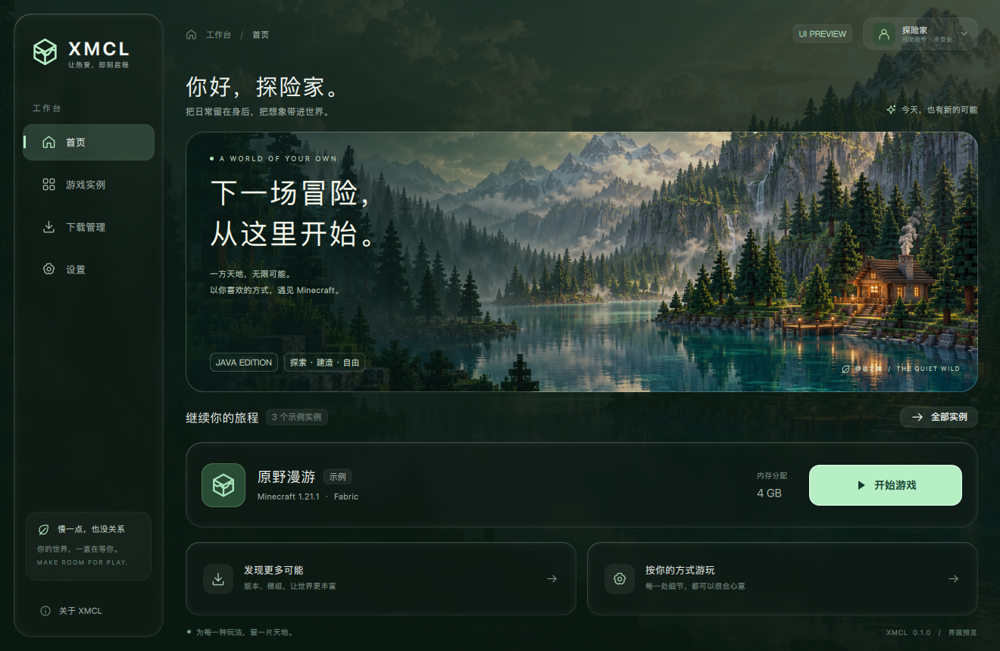

# XMCL

面向日常玩家的 Minecraft 启动器，使用 **C++17、Qt Quick/QML**。保留深色森林、圆角与液态玻璃主界面，通过新增功能面板接入原生业务。



当前为 **0.2.0 Native Preview**。KAMUCL README 的模块迁移仍在进行，不能视为全部功能已等价完成。逐项范围与缺口见 [迁移清单](docs/migration/STATUS.md)。

## 使用入口

- `Ctrl+Shift+M` 打开功能面板；模块栏可横向滚动。
- 右上角账号按钮：未登录时直接进入微软正版设备码登录；登录后可管理离线、Yggdrasil 账号与皮肤衣柜。
- 实例页「探索新版本」：版本清单与安装；右键实例：管理、配置与备份；实例卡片右上角「设置」打开实例设置。
- 实例设置：每个实例独立保存自己的 Java 路径、内存、JVM/游戏参数与窗口尺寸；内存可用「智能分配」按本机物理内存自动计算；Java 扫描后可自动匹配该版本要求的主版本。
- 启动检查：首页「开始游戏」先检查 Java 匹配、客户端/库/资源缺失或大小不符；缺失文件可「一键修复」，失败后显示基于最近日志的诊断建议与对应设置入口。
- 下载页：「下载游戏」打开专用安装弹窗；「模组与资源」打开社区资源下载弹窗（搜索、选文件、选实例后一键安装）；任务卡片支持暂停/继续、失败重试与取消，并标明当前下载源。
- 设置页「游戏与下载」：默认内存（支持按本机内存「智能分配」）与下载源（官方源 / BMCLAPI 镜像）；未单独设置的实例使用默认内存，单个实例可在实例设置中覆盖。
- 设置页「外观与体验」标题：主题色、背景、快捷键、缩略图与原生插件。
- 在功能面板切换到「联机」「诊断与更新」使用对应模块。

首次使用：创建实例 → 添加/选择账号 → 查询并安装游戏及加载器 → 首页启动。导入整合包后，需按整合包指定版本安装游戏与加载器。无本地实例时显示三张示例卡片；它们不会启动游戏。

微软正版登录使用内置的公共客户端身份（公开 Client ID，非密钥，参考 KAMUCL，见 [第三方声明](THIRD_PARTY_NOTICES.md)），只要使用个人 Microsoft 账户并拥有 Minecraft Java Edition 即可直接开始设备码授权（工作/学校账号，如 `xxx.onmicrosoft.com`，不支持）；也可以在同一表单中换用自己的 Microsoft OAuth 应用 Client ID。CurseForge 需要自己的 API Key。macOS 凭据保存至系统钥匙串，通用面板不接收访问令牌；`accounts.json` 只保存昵称/UUID 等元数据。Windows/Linux 凭据存储尚未实现，联网账号不会退化为明文保存。设备码只在本机登录时使用，请不要把代码告诉他人；完整的风险与边界见 [账号安全说明](docs/migration/ACCOUNT-SECURITY.md)。自己申请 Client ID 的步骤（含 Minecraft API 审核）见 [微软应用注册指引](docs/migration/MICROSOFT-APP-REGISTRATION.md)。

下载源默认使用官方源（Mojang、Fabric、Quilt、Forge、NeoForge、authlib-injector 等官方地址）。设置页可切换为 BMCLAPI 镜像加速：BMCLAPI 由 bangbang93 提供（[文档](https://bmclapidoc.bangbang93.com/)），XMCL 只在其公开 API 路由上把 Mojang/Fabric/Forge/NeoForge/authlib-injector 地址改写为镜像地址，不镜像 Quilt、Modrinth/CurseForge 社区资源与整合包；Forge/NeoForge 安装器进程自身发起的库下载也不受该开关影响。使用镜像时下载界面会标明来源，所有文件仍按官方摘要校验；镜像节点限流或波动时下载器会保留 `.part` 做有限重试，镜像不可用时会自动回退官方源（同一次下载中后续文件直接走官方源，避免反复等待）。

FRP/Terracotta 使用用户提供的官方本机工具和服务配置，不在后台自动创建公网连接。原生插件使用 XMCL Qt ABI，不兼容 Electron 插件；安装不执行，明确启用后才加载。详见 [插件接口](docs/migration/NATIVE-PLUGINS.md)。

## 构建与运行

依赖 CMake 3.21+、C++17、**Qt 6.7+**（Quick、Quick Controls 2、Quick3D、Network、Svg、ShaderTools；测试另需 Test）、libarchive。当前在 macOS Apple Silicon / Qt 6.9.3 验证，Windows/Linux 尚未实机测试。玻璃与三维预览需要 Qt 支持的图形后端，macOS 使用 Metal。

```sh
cmake -S . -B build -DCMAKE_PREFIX_PATH='/opt/homebrew;/opt/homebrew/opt/libarchive' -DBUILD_TESTING=ON
cmake --build build -j4
ctest --test-dir build --output-on-failure
open build/XMCL.app
```

Qt 安装位置不同可替换 `CMAKE_PREFIX_PATH`。仅构建应用使用 `-DBUILD_TESTING=OFF`。当前产物依赖本机 Qt/libarchive，尚未制作可独立分发的安装包。

Bridge 游戏端 JAR 已放入 `bridge/dist/` 并由 CMake 打包，可用 `python3 bridge/build.py` 从保留的 Java 源重建（需要 JDK 17+）。它面向 Fabric，只有主动注册 Bridge 接口的 MOD 参数可管理。

## 验证

13 组 CTest 覆盖控制器、实例与资源、账号、真实回环下载、游戏安装/修复与启动参数、Java 运行时扫描/匹配/缓存、Bridge、整合包、个性化与示例插件、联机进程/HTTP、维护更新、社区取消/重试竞态和生产 QML 交互。UI 测试会从真实界面驱动下拉菜单对比度检查、微软登录入口与设备码提示、游戏安装下载、失败重试、社区资源搜索/安装、实例设置（智能内存、Java 路径，且只影响目标实例）、启动检查弹窗以及小窗口滚动可达性，并把验证截图写入 `build/ui-verified/`。

常规测试使用本地夹具，不访问公网。设置 `XMCL_LIVE=1` 可额外运行真实微软设备码申请、Mojang 版本清单与 Modrinth 真实下载；`XMCL_LIVE_MIRROR=1` 验证 BMCLAPI 镜像映射与 authlib-injector 下载；`XMCL_LIVE_OLD_INSTALL=1` 会真实安装一个小体积旧版本（约 60 MB），并执行启动前检查与真实 Java 匹配；`XMCL_LIVE_JAVA=1` 验证本机 Java 发现与匹配。命令行示例：

```sh
XMCL_LIVE=1 ./build/tst_accounts liveMicrosoftDeviceCodeStartsWithBuiltInClientId
XMCL_LIVE=1 ./build/tst_game liveVersionListFromMojang
XMCL_LIVE=1 ./build/tst_community liveModrinthDownload
XMCL_LIVE_MIRROR=1 ./build/tst_game liveMirrorVersionListAndAuthlib
XMCL_LIVE_MIRROR=1 ./build/tst_download liveMirrorFileDownload
XMCL_LIVE_JAVA=1 ./build/tst_java liveFindsInstalledJava
XMCL_LIVE_OLD_INSTALL=1 ./build/tst_game liveInstallDownloadsRealFiles
```

界面验证截图：[下载源设置与智能内存](docs/screenshots/settings.png)、[BMCLAPI 镜像已选](docs/screenshots/download-source.png)、[实例设置与智能分配](docs/screenshots/instance-settings.png)、[首页实例内存](docs/screenshots/home-instance-memory.png)、[启动检查](docs/screenshots/launch-check.png)、[下拉菜单](docs/screenshots/dropdown.png)、[微软设备码](docs/screenshots/accounts.png)、[社区资源下载](docs/screenshots/community.png)。真实微软账号完成授权、全加载器安装或公网双端联机仍需人工验收。具体记录见 [STATUS.md](docs/migration/STATUS.md)。

```sh
./build/XMCL.app/Contents/MacOS/XMCL --clean-settings --screenshot build/home.png
./build/XMCL.app/Contents/MacOS/XMCL --clean-settings --page 1 --size 1060x720 --screenshot build/library.png
./build/XMCL.app/Contents/MacOS/XMCL --clean-settings --module instances --screenshot build/features.png
./build/XMCL.app/Contents/MacOS/XMCL --clean-settings --preview-skin /absolute/skin.png --screenshot build/skin.png
```

`--clean-settings` 使用临时偏好及数据目录；不带它则保存用户数据。macOS 默认数据位于 `~/Library/Application Support/XMCL/XMCL/`。备份在数据目录 `backups/`，日志在 `logs/`。皮肤预览支持经典/纤细、64×64/64×32，以及拖动旋转、滚轮缩放。

## 项目结构

```text
src/services/       C++ 实例、安装、账号、资源、联机、维护与插件
ui/                 保留的主界面、功能面板、三维皮肤预览
shaders/            液态玻璃 GLSL
assets/             背景与 SVG 图标
bridge/             独立 Fabric MOD 源码与可重建 JAR
examples/           可编译的原生插件示例
tests/              单元和集成测试
docs/migration/     功能范围、验证与协议说明
```

背景与素材说明见 [ARTWORK.md](assets/ARTWORK.md)，第三方来源见 [THIRD_PARTY_NOTICES.md](THIRD_PARTY_NOTICES.md)。XMCL 与 Mojang/Microsoft 无隶属关系。
